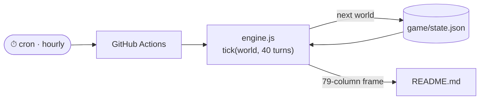

<div align="center">


<br />
<br />

**Student & Python developer**, curious about generative AI and learning by building.

[](https://abhra.me)
[](mailto:abhraayan@gmail.com)
[](https://github.com/abhrajyoti-01)


</div>

<br />

## `01` &nbsp;whoami

```python
class Abhrajyoti:
    role       = "student · Python developer"
    location   = "Karimpur, West Bengal, India"
    interested = ["generative AI", "LLMs", "AI-powered apps"]
    works_with = ["Python", "FastAPI", "Pydantic", "JavaScript"]
    approach   = "learning by building small, real projects"
    site       = "https://abhra.me"
```

<br />

## `02` &nbsp;/dev/dungeon

A **zero-player roguelike that lives inside this README.** Nobody controls it, not even me. Every hour a GitHub Action loads the world from [`game/state.json`](game/state.json), simulates 40 turns and commits the next frame. The daemon `@` explores a procedurally generated filesystem, squashes bugs, picks up better debugging tools and goes deeper until something kills it. Then the next daemon is forked.

<!-- DUNGEON:START -->
```diff
@@ /dev/dungeon · daemon #001 · depth 01 /home · turn 000040 @@
 ┌─────────────────────────────────────────────────────┬──────────────────────┐
 │                                                     │ DAEMON #001   lvl 01 │
 │                                   ┌──────────┐      │ pid 22567    hunting │
 │                                   │··········│      │                      │
 │                     ┌───────┐     │··········│      │ HP █████████   30/30 │
 │                     │?······│ ░░░░+··········│      │ XP ░░░░░░░░░      0% │
 │                     +··x··@·│ ░   └─────+────┘      │                      │
 │                     └─────+─┘ ░         ░           │ atk 08        def 01 │
 │                           ░  ░░         ░           │ ) gdb             +4 │
 │                           ░░░░      ┌───+──────┐    │ [ no_tests        +0 │
 │                           ░         │··········│    │ ! hotfix          x1 │
 │                                     │··········│    │ * stars            0 │
 │                                     └──────────┘    │                      │
 │                                                     │ depth 01   kills 000 │
 │                                                     │                      │
 │                                                     │ in view            1 │
 │                                                     │ x off_by_one     ███ │
 │                                                     │                      │
 ├─────────────────────────────────────────────────────┴──────────────────────┤
 │ /home 48% mapped · record depth 01 by #001 · 0 daemons lost                │
 └────────────────────────────────────────────────────────────────────────────┘
# 000000  fork    daemon #1 spawned in /home · pid 22567
! 000011  equip   gdb (+4 atk) replaces printf
```

<p align="center"><sub>frame <b>#1</b> · rendered 2026-10-28 16:23 UTC by GitHub Actions · 40 turns per frame · next frame within the hour</sub></p>

<details>
<summary><b>Graveyard</b> · 0 daemons lost · 0 bugs squashed · deepest dive: depth 1 by daemon #1</summary>
<br />

_No daemon has died yet. Give it time._

</details>
<!-- DUNGEON:END -->

<details>
<summary><b>Legend, rules & architecture</b></summary>
<br />

| glyph | what it is | glyph | what it is |
| :-: | :-- | :-: | :-- |
| `@` | **the daemon**, fully autonomous | `!` | **hotfix**, applied when HP runs low |
| `b` `x` `n` | bug · off_by_one (misses) · null_pointer | `)` | **debugging tool**, weapon: `grep` → `gdb` → `valgrind` → `ebpf` |
| `l` `r` | memory_leak (regenerates) · race_condition (acts twice) | `[` | **safety net**, armour: `linter` → `type_system` → `formal_proof` |
| `z` `H` | zombie_process (revives) · heisenbug (moves when observed) | `?` | **docs**, reveal the whole floor |
| `S` `D` | segfault (crits) · **deadlock**, boss every 5th depth | `*` `>` | stars (score) · deploy to the next depth |

**The AI**, in priority order: patch when hurt → fight what's adjacent → chase what's awake → rest → hunt → loot → explore the nearest unmapped edge → deploy downstairs.
Every floor is a directory (`/home` → `/usr/src` → … → `/root` → `/dev/null`). Monsters scale per depth, and a deadlock waits on every fifth floor.



Deterministic by design: the seeded PRNG state is stored with the world, so a frame is a pure function of the previous one. Zero dependencies, vanilla JS, and the log colours come from GitHub's own `diff` highlighter.

</details>

<br />

## `03` &nbsp;Featured: AI HealthCare Assistant

<table>
<tr>
<td width="60%" valign="top">

### [AI-HealthCare-Application](https://github.com/abhrajyoti-01/AI-HealthCare-Application)

An **AI-powered healthcare chatbot** that gives educational medical guidance, detects emergency keywords, and shows practical **large language model (LLM) integration** with a fallback architecture, so it keeps answering when a model call fails.

`Python` `LLM` `generative AI` `chatbot`

</td>
<td width="40%" valign="top">

```text
 user message
      │
      ▼
 emergency keywords? ──▶ urgent guidance
      │ no
      ▼
 LLM ──(fails)──▶ fallback
      │
      ▼
 educational answer
```

</td>
</tr>
</table>

<br />

## `04` &nbsp;Selected work

<table>
<tr>
<td width="50%" valign="top">

### [arequest](https://github.com/abhrajyoti-01/arequest)

`Python` `asyncio` `HTTP`

Asynchronous HTTP client with a `requests`-compatible API: simple, fast and built for concurrency.

- familiar `requests`-style interface
- full `async` / `await` support
- connection pooling and automatic retries

</td>
<td width="50%" valign="top">

### [attendance-tracker](https://github.com/abhrajyoti-01/attendance-tracker)

`Python` `FastAPI` `computer vision`

Face-recognition attendance system with liveness anti-spoofing and per-organisation isolation.

- MTCNN face detection with ONNX FaceNet embeddings
- liveness checks: LBP texture, blink, head movement
- FastAPI, PostgreSQL, Redis and Celery behind a React dashboard

</td>
</tr>
<tr>
<td width="50%" valign="top">

### [BWU-Portal-Lite](https://github.com/abhrajyoti-01/BWU-Portal-Lite)

`Python` `Telegram bot`

Telegram bot for Brainware University student self-service: attendance, fees, marks and notices, right inside the chat.

- everything in one chat
- no student data stored
- more features on the way

</td>
<td width="50%" valign="top">

### [QuizGame](https://github.com/abhrajyoti-01/QuizGame)

`Python` `vanilla JS`

Browser-based multiple-choice quiz game with 1,009 questions across 20 topics.

- Python server, vanilla JS frontend
- zero dependencies
- runs anywhere Python does

</td>
</tr>
</table>

<sub>Also on my GitHub: <a href="https://github.com/abhrajyoti-01/user-management-api">user-management-api</a> (FastAPI + Pydantic v2) · <a href="https://github.com/abhrajyoti-01/Pythia">Pythia</a> (a small SQL database in C, built to learn how databases work) · <a href="https://github.com/abhrajyoti-01/dsa-in-c">dsa-in-c</a> · <a href="https://github.com/abhrajyoti-01/AuthFlow">AuthFlow</a></sub>

<br />

## `05` &nbsp;Activity

<sub>Regenerated every hour from the GitHub API by <a href=".github/scripts/update-readme.js"><code>update-readme.js</code></a>.</sub>

<!-- GH:STATS:START -->
<table align="center"><tr><td align="center" width="25%"><strong>31</strong><br /><sub>Repositories</sub></td><td align="center" width="25%"><strong>8</strong><br /><sub>Stars</sub></td><td align="center" width="25%"><strong>9</strong><br /><sub>Forks</sub></td><td align="center" width="25%"><strong>10</strong><br /><sub>Followers</sub></td></tr><tr><td align="center" width="25%"><strong>168</strong><br /><sub>Contributions (1y)</sub></td><td align="center" width="25%"><strong>124</strong><br /><sub>Commits (1y)</sub></td><td align="center" width="25%"><strong>2</strong><br /><sub>Pull requests</sub></td><td align="center" width="25%"><strong>0</strong><br /><sub>Issues opened</sub></td></tr></table>
<!-- GH:STATS:END -->

<!-- GH:LANGUAGES:START -->
> Byte-weighted across public, non-fork, non-archived repositories.

| Rank | Language | Share |
| :-: | :-- | :-: |
| **01** | `C` | **29.3%** |
| **02** | `JavaScript` | **26.2%** |
| **03** | `TypeScript` | **20.0%** |
| **04** | `Python` | **16.5%** |
| **05** | `Go` | **3.9%** |
| **06** | `Rust` | **1.9%** |
| **07** | `PHP` | **1.9%** |


<sub>Plus 3 additional languages.</sub>
<!-- GH:LANGUAGES:END -->

**Most starred**

<!-- GH:TOP_REPOS:START -->
<table><tr><td width="6%"><strong>01</strong></td><td><a href="https://github.com/abhrajyoti-01/arequest"><strong>arequest</strong></a><br /><sub>🚀 High-performance asynchronous HTTP client with a requests-compatible API — simpl…</sub></td><td align="right"><sub>★ 3 · forks 1 <code>Python</code></sub></td></tr><tr><td width="6%"><strong>02</strong></td><td><a href="https://github.com/abhrajyoti-01/AuthFlow"><strong>AuthFlow</strong></a><br /><sub>AuthFlow is a robust, full‑stack authentication system built with React (frontend)…</sub></td><td align="right"><sub>★ 1 · forks 3 <code>JavaScript</code></sub></td></tr><tr><td width="6%"><strong>03</strong></td><td><a href="https://github.com/abhrajyoti-01/LocalStore"><strong>LocalStore</strong></a><br /><sub>LocalStore is a modern e-commerce platform designed to connect customers with authe…</sub></td><td align="right"><sub>★ 1 · forks 2 <code>TypeScript</code></sub></td></tr><tr><td width="6%"><strong>04</strong></td><td><a href="https://github.com/abhrajyoti-01/employee-management-system"><strong>employee-management-system</strong></a><br /><sub>A modern full-stack web application for efficient employee record management</sub></td><td align="right"><sub>★ 1 · forks 2 <code>JavaScript</code></sub></td></tr><tr><td width="6%"><strong>05</strong></td><td><a href="https://github.com/abhrajyoti-01/typing-master"><strong>typing-master</strong></a><br /><sub>A platform where you can test your typing speed.</sub></td><td align="right"><sub>★ 1 · forks 0 <code>TypeScript</code></sub></td></tr><tr><td width="6%"><strong>06</strong></td><td><a href="https://github.com/abhrajyoti-01/rock_paper_game"><strong>rock_paper_game</strong></a><br /><sub>Simple Rock - Paper - Scissors Game using Node.js</sub></td><td align="right"><sub>★ 1 · forks 0 <code>JavaScript</code></sub></td></tr></table>
<!-- GH:TOP_REPOS:END -->

**Recently pushed**

<!-- GH:RECENT:START -->
<table><tr><td width="6%"><strong>01</strong></td><td><a href="https://github.com/abhrajyoti-01/UnRAR"><strong>UnRAR</strong></a><br /><sub>UnRAR — open-source WinRAR-style archive manager in Rust (egui). ZIP/RAR/7z/TAR/GZ/…</sub></td><td align="right"><sub><code>Rust</code> · 41 mins ago</sub></td></tr><tr><td width="6%"><strong>02</strong></td><td><a href="https://github.com/abhrajyoti-01/QuizGame"><strong>QuizGame</strong></a><br /><sub>Browser-based multiple-choice quiz game with 1,009 questions across 20 topics - Pyt…</sub></td><td align="right"><sub><code>Python</code> · 4 hours ago</sub></td></tr><tr><td width="6%"><strong>03</strong></td><td><a href="https://github.com/abhrajyoti-01/BWU-Portal-Lite"><strong>BWU-Portal-Lite</strong></a><br /><sub>Brainware Portal Lite - Telegram bot for Brainware University Student Self-Service:…</sub></td><td align="right"><sub><code>Python</code> · 19 days ago</sub></td></tr><tr><td width="6%"><strong>04</strong></td><td><a href="https://github.com/abhrajyoti-01/Student-Management-System"><strong>Student-Management-System</strong></a><br /><sub>College DBMS project of Brainware University | Student Management System web app wi…</sub></td><td align="right"><sub><code>PHP</code> · 28 days ago</sub></td></tr><tr><td width="6%"><strong>05</strong></td><td><a href="https://github.com/abhrajyoti-01/arequest"><strong>arequest</strong></a><br /><sub>🚀 High-performance asynchronous HTTP client with a requests-compatible API — simpl…</sub></td><td align="right"><sub><code>Python</code> · 1 month ago</sub></td></tr></table>
<!-- GH:RECENT:END -->

<br />

## `06` &nbsp;Stack

<!-- GH:TECH:START -->
<div align="center">

**Languages & runtimes**


**Frameworks & delivery**


**Infrastructure**


</div>
<!-- GH:TECH:END -->

<br />

---

<div align="center">

**Into Python or generative AI? I'm always happy to learn, collaborate or just talk shop.**

[abhra.me](https://abhra.me) &nbsp;·&nbsp; [abhraayan@gmail.com](mailto:abhraayan@gmail.com) &nbsp;·&nbsp; [@abhrajyoti-01](https://github.com/abhrajyoti-01)

<sub>This README rebuilds itself every hour: live stats from the GitHub API plus a fresh frame of /dev/dungeon, with no manual edits.</sub>

</div>
